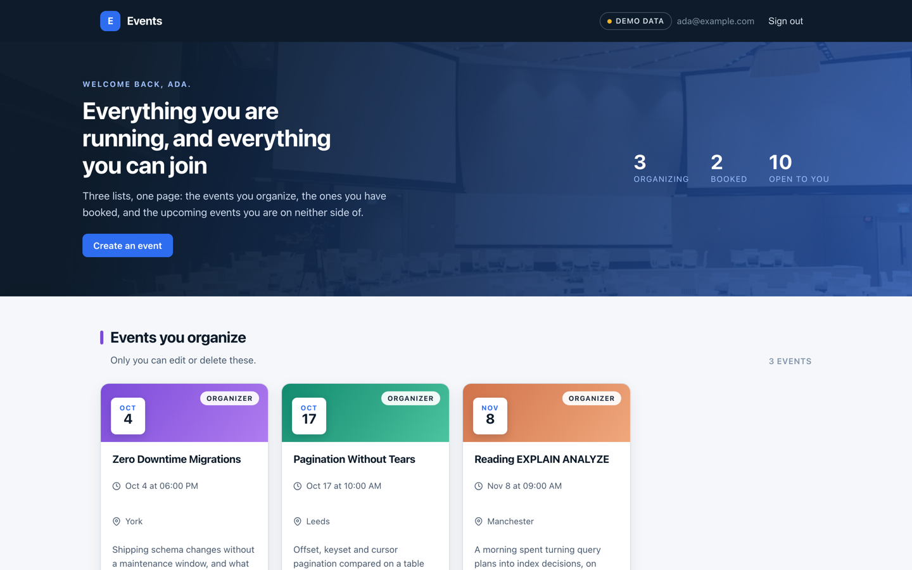
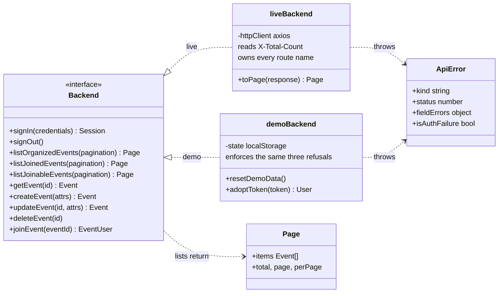
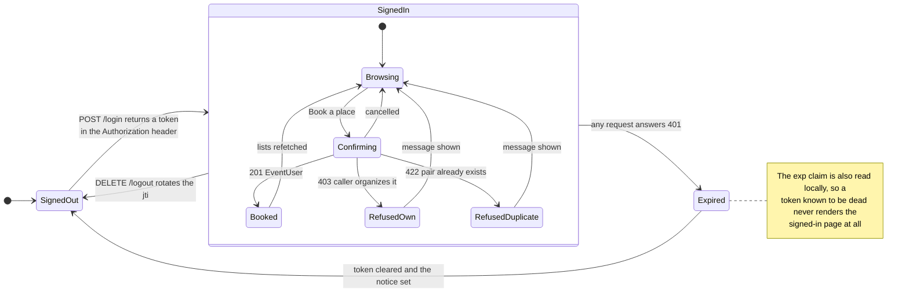
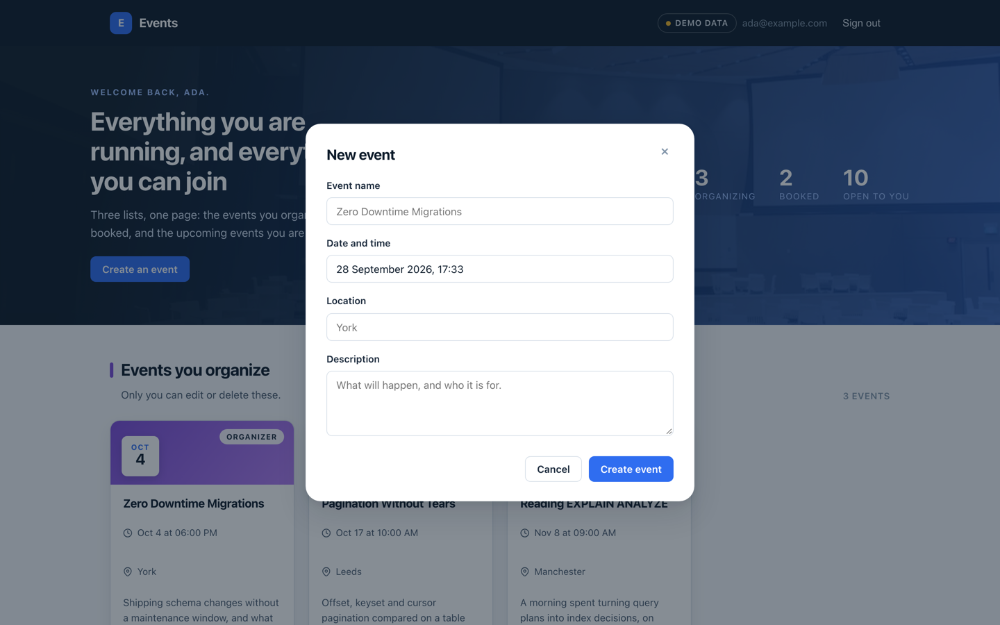
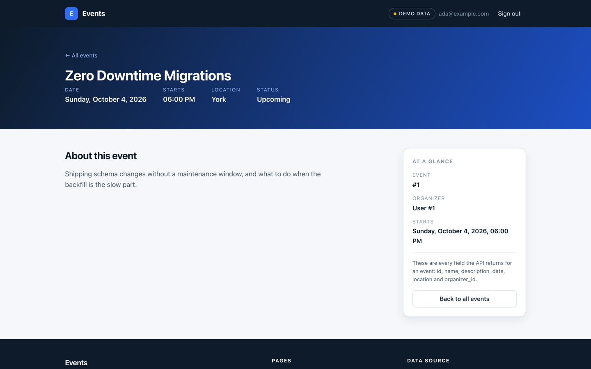

# Event listing web UI

A React client for `event_management_app_BE`, a Rails 7.1 JSON API. It shows a signed-in user three lists at once — the events they organize, the
events they have booked a place at, and the upcoming events they are on neither side of —
and lets them create, edit, delete and book.

It also runs with no API at all. `npm start` on a fresh clone boots against sixteen seeded
fixture events, so the screenshots below are something you can reproduce in about ninety
seconds.



## Ninety seconds, no backend

```bash
npm install
npm start          # http://localhost:3001
```

The sign-in form arrives with `ada@example.com` / `password123` already filled in, because
a demo you cannot get past is not a demo. `grace@example.com` and `alan@example.com` also
exist with the same password, and signing in as one of them shows a completely different
three lists — the quickest way to see that the organizer rules are real and not cosmetic.

A **DEMO DATA** badge sits in the header whenever the fixtures are in use, and everything
you change is kept in `localStorage`.

## Three lists, and why an event is only ever in one

The API models two relationships between a user and an event: `organizer_id` on the event
is ownership, a row in `event_users` is a booking, and policy keeps them mutually
exclusive. That is why the home page is three lists rather than one with filters — each is
a separate endpoint whose scope the server, not the client, decides.

| Section on the page | Endpoint | What it contains |
|---|---|---|
| Events you organize | `GET /api/v1/events` | events where you are the organizer |
| Events you have booked | `GET /api/v1/events/joined_events` | events you hold a booking for |
| Upcoming events open to you | `GET /api/v1/events/get_events` | future events on neither edge |

The three sections differ only in the endpoint they call and the sentence they show when
empty, so they are three calls to one `<EventSection>` fed by one `useEventCollection`
hook. A fourth list would be a fourth call, not a fourth component.

Booking an event moves it out of the third list and into the second, and deleting one
removes it from every list it could be in. Rather than splice each array by hand, a
mutation bumps a revision counter in `EventContext` and every section refetches — three
requests, and a whole class of "the lists disagree with each other" bug gone.

## The API contract lives in one file

`src/api/liveBackend.js` is the only module that knows a URL. It owns the server's route
names — including `add_user_to_events`, `get_events` and `joined_events`, which are the
server's spelling and not this project's — and the rest of the client speaks in domain
verbs instead.

Three details of that contract are easy to get wrong:

- **The JWT arrives in the `Authorization` *response header* of `POST /login`, not the
  body**, and a browser can only read it because the API sends
  `Access-Control-Expose-Headers: Authorization`. If login silently fails against your own
  deployment, check that header first.
- **The stored token already begins with `Bearer `** and is sent back byte for byte. A
  second prefix produces `Bearer Bearer …` and a 401 that looks like an expired session.
- **`add_user_to_events` takes `event_id` as a query parameter** and no body, answering 403
  when the caller organizes the event and 422 when they already hold a booking — domain
  outcomes, not faults, and each gets its own sentence.

Swapping the fixtures for the real API is a one-line change in `src/api/index.js`, because
both modules export the same functions with the same signatures and the same errors:



`demoBackend` is not a mock of the HTTP layer — it replaces it. It enforces the same three
refusals the API enforces (only the organizer may edit or delete, nobody may book their own
event, nobody may book twice), paginates the same way, and returns the same `ApiError`
kinds — so a bug in how the UI handles a 403 shows up in demo mode too.

## From signed out to booked, and the ways it is refused



`Expired` is the transition worth the trouble. Deciding "signed in" from the mere presence
of a token in `localStorage` means a stale one renders the whole signed-in page and then
fails every request on it — three error panels over three empty lists. Instead
`src/auth/session.js` reads the `exp` claim before trusting the token, and one response
interceptor in `src/api/httpClient.js` turns any 401 into a single sign-out and a single
message rather than one error per in-flight request. An opaque token with no readable `exp`
is left for the server to judge.

## Errors the user can act on

The API answers failures in three shapes, and `src/api/apiError.js` is the only place that
knows them:

| Shape | When | What the UI does |
|---|---|---|
| `{"errors": ["…"]}` | 400, 403, 404, 500 | shows the sentence |
| `{"attributes_errors": {"field": ["…"]}}` | 422 | puts each message under its own input |
| `{"status": ["…"]}` | the Devise signup route | shows the sentence |

`status` is an object on a successful signup and an array on a failed one, so the array
check runs first. There is a test for exactly that.



## Paging, because the API caps the page

Every list endpoint accepts `page` and `per_page` and answers with `X-Total-Count`,
`X-Page` and `X-Per-Page`. `per_page` defaults to 50 and is capped at 100, so a client that
sends no parameters and renders `response.data` silently shows the first 50 rows of however
many exist.

`liveBackend` reads all three headers and returns `{ items, total, page, perPage }`, so the
pager is driven by `total` rather than by whether the last response happened to look full.
The default page size is 8 cards — `REACT_APP_PAGE_SIZE` changes it.

## Pointing it at the real Rails API

```bash
cp .env.example .env.local
# set REACT_APP_API_BASE_URL=http://localhost:3000
npm start
```

Setting `REACT_APP_API_BASE_URL` to a non-empty value turns demo mode off; leaving it blank
turns it on. `REACT_APP_DEMO` overrides that either way.

Create React App inlines `REACT_APP_*` at build time, so these are build inputs, not
runtime configuration — changing one needs a rebuild, not a restart. Nothing outside
`src/config.js` reads `process.env`.

Boot the API first (`bin/rails server`, port 3000) and run `bin/rails db:seed` there so its
users exist.



## Tests

```bash
npm run test:ci
```

**99 tests in 6 suites, all passing**, with no console warnings in the run. They cover the
error-envelope parser, token expiry and storage, the fixture backend's domain rules, the
date helpers, and the live backend's exact paths, parameters and pagination headers with
`httpClient` mocked. The component tests drive the UI through the fixture backend — signing
in, booking an event, watching it move between two lists.

`npm run lint` (ESLint, `react-app` plus `prettier`) and `npm run format:check` both pass
clean.

## Container

```bash
docker compose build --build-arg REACT_APP_API_BASE_URL=https://api.example.com
docker compose up
```

Two stages: Node 22 compiles the bundle, nginx 1.27 serves it as the unprivileged `nginx`
user from a read-only root filesystem, with `try_files … /index.html` so React Router owns
the routes. Assets under `/static/` are fingerprinted and cached for a year, `index.html`
is not cached at all.

`docker compose config` parses. **The image has not been built or booted** — Docker is off
on the machine this was last worked on, so treat the Dockerfile as reviewed, not verified.

## Known gaps

- There is no `GET /me`, so after a reload the client knows it holds a valid token but not
  whose it is: the header shows an email only until the next reload, and an event page
  names its organizer as `User #2`.
- The search and date filters a list this size will eventually want do not exist. The API
  has no query parameters for them either, so adding them client-side would only filter the
  current page and would lie about the total.
- `npm audit` reports 30 advisories (9 low, 7 moderate, 14 high), all of them inside the
  `react-scripts@5.0.1` build toolchain — jest, jsdom, the svgr and webpack plugins. None
  ship in the bundle, but Create React App is unmaintained and the real fix is Vite.
- No end-to-end test runs against the real API. The contract is asserted against a mocked
  HTTP client, which catches a wrong path or a missing header but not a server that changed
  shape underneath it.

## Author

[**Muhammad Nadeem**](https://github.com/dev-mnadeem)
